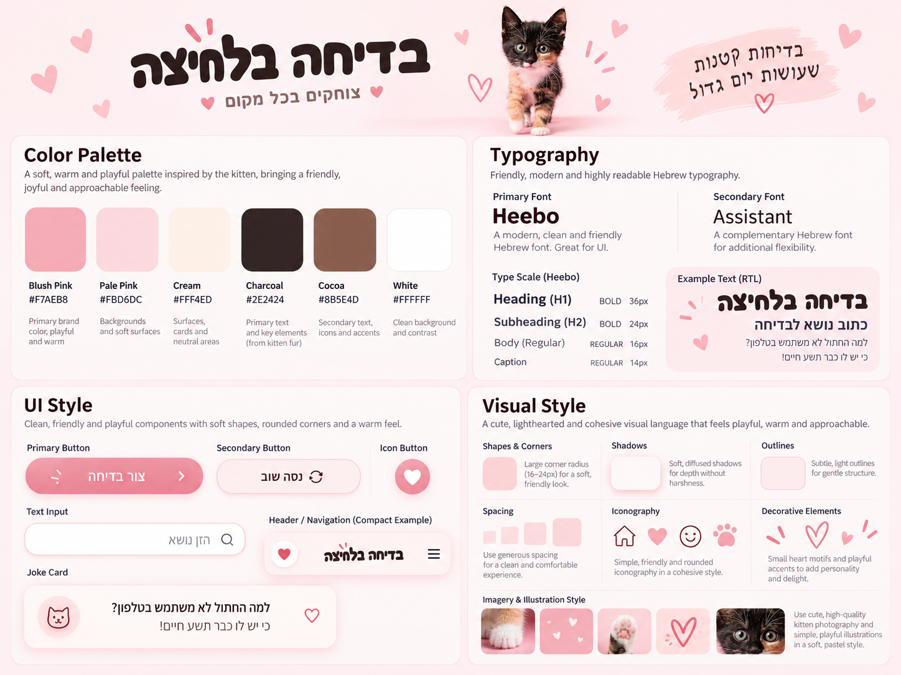

# DESIGN — בדיחה בלחיצה

מסמך זה מתאר את מימוש העיצוב של אפליקציית המובייל **"בדיחה בלחיצה"**. דרישות ההתנהגות והאילוצים מוגדרים ב-`PRD.md`; כאן מתועדים מבנה המסך והשפה החזותית בלבד.

**סדר עדיפויות במקרה של אי־התאמה:** ה-PRD קובע אילו יכולות מותרות; ה-Wireframes קובעים את מבנה המסך ורכיביו; ה-Style Guide קובע את השפה החזותית; ה-Mockups מדגימים את המראה הרצוי. אין להוסיף פונקציונליות בעקבות אלמנט דקורטיבי בתמונה.

## 1. Screens – מסכי האפליקציה

### 1.1 בדיחה בלחיצה — המסך היחיד

**מטרת המסך:** לאפשר הזנת נושא, יצירת בדיחה והצגתה מיידית באותו מסך.

**מבנה ותוכן — לפי ה-Wireframe, מלמעלה למטה:**

1. **כותרת ראשית:** "בדיחה בלחיצה", בראש התצוגה.
2. **שדה נושא:** תווית ימנית המתארת את נושא הבדיחה ושדה קלט יחיד עם דוגמה לנושא. השדה מאפשר עד 100 תווים ואינו חובה.
3. **כפתור פעולה מרכזי:** "צור בדיחה", מתחת לשדה, ברוחב בולט ובהיררכיה חזותית ראשית.
4. **אזור בדיחה:** כותרת אזור ואחריה כרטיס תוכן בעל פינות מעוגלות, המציג את הבדיחה. ה-Wireframe מציג בדיחה לדוגמה; ה-Mockup מציג את אותו אזור במצב שלפני יצירה, עם איור והודעת Placeholder. אלה שני מצבי תוכן של **אותו רכיב באותו מסך**, לא מסכים נפרדים.

**הדגשים במראה הסופי:** כותרת כהה על רקע ורוד, תמונת חתלתול כחלק מאזור הכותרת, שדה קלט לבן בעל מסגרת ורודה עדינה, כפתור ורוד בולט, וכרטיס בדיחה ורדרד. מתחת לשדה מוצג **מונה תווים** בפורמט `<מספר>/100` (למשל `0/100`), בגודל Caption, כחיווי משני בלבד — ללא שינוי בלוגיקת המוצר.

**טקסטים במסך (נוסח מחייב):**

| רכיב | טקסט |
|---|---|
| כותרת ראשית (H1) | בדיחה בלחיצה |
| תווית השדה (H2, משמשת גם כ-`label` של השדה) | על מה תרצו בדיחה? |
| Placeholder בשדה | לדוגמה: חתולים, עבודה, טכנולוגיה... |
| מונה תווים | `0/100` |
| כפתור | צור בדיחה |
| כותרת מעל כרטיס הבדיחה | הבדיחה שלך |
| כרטיס ריק (לפני בדיחה ראשונה) | הבדיחה תופיע כאן לאחר הלחיצה |
| טעינה | מכין לך בדיחה... |
| שגיאה כללית | לא הצלחנו ליצור בדיחה כרגע. אפשר לנסות שוב. |
| נושא ארוך מדי (מהשרת) | הנושא ארוך מדי. אפשר עד 100 תווים. |
| אין חיבור | נדרש חיבור לאינטרנט כדי ליצור בדיחה |

הנוסח "על מה תרצו בדיחה?" מחליף את "על מה תרצה בדיחה?" שב-Mockup ואת "נושא הבדיחה" שב-Wireframe, כדי לפנות לכל המשתמשים. הכותרת "הבדיחה שלך" נלקחה מה-Wireframe, שקובע את מבנה המסך.

**פעולות וניווט:** המשתמש מזין נושא, לוחץ על "צור בדיחה", וקורא את התוצאה באותו אזור. לחיצה נוספת מחליפה את הטקסט באותו כרטיס. חיווי הטעינה "מכין לך בדיחה..." והודעות השגיאה או ה-Offline מופיעים בתוך המסך הקיים, ללא מעבר למסך אחר; בתקופת טעינה הכפתור מושבת בהתאם ל-PRD.

**הבהרת סתירה חזותית:** ב-Mockup מופיע אייקון תפריט (שלושה קווים) שלא קיים ב-Wireframe ושסותר את דרישת ה-PRD למסך יחיד ללא תפריטים. **אין לממש תפריט או אייקון תפריט פעיל.** גם הלבבות, טביעת הכף והניצוצות הם קישוטים בלבד ואינם פעולות חדשות.

### 1.2 מצבי המסך

כל המצבים מוצגים באותו מסך. **שורת סטטוס** אחת ממוקמת בין הכפתור לבין כותרת "הבדיחה שלך", ומשמשת להודעות טעינה, שגיאה ו-Offline (עם `aria-live="polite"`). כשאין הודעה, השורה אינה תופסת מקום.

| מצב | כפתור | שורת סטטוס | כרטיס הבדיחה |
|---|---|---|---|
| **התחלתי** (לפני בדיחה ראשונה) | פעיל | ריקה | מצב ריק: אייקון סמיילי ורוד + "הבדיחה תופיע כאן לאחר הלחיצה", כמו ב-Mockup |
| **טעינה** | מושבת: שקיפות 60%, ללא צל, הסמן אינו מגיב | "מכין לך בדיחה..." בטקסט Charcoal, עם אנימציית נקודות עדינה | ללא שינוי: הבדיחה הקודמת או המצב הריק נשארים |
| **הצלחה** | פעיל | ריקה | טקסט הבדיחה החדשה, מחליף את הקודם |
| **שגיאה** | פעיל (לניסיון חוזר) | הודעת השגיאה המתאימה, בתוך "גלולה" ברקע לבן עם מסגרת Rose דקה וטקסט Charcoal | ללא שינוי: הבדיחה הקודמת או המצב הריק נשארים |
| **Offline** | פעיל | "נדרש חיבור לאינטרנט כדי ליצור בדיחה", באותו עיצוב של הודעת שגיאה | ללא שינוי |

אין מודאלים, חלונות קופצים או הודעות Toast. כשהמשתמש לוחץ שוב, שורת הסטטוס מתעדכנת למצב הטעינה.

### 1.3 מבנה ניווט

לאפליקציה מסך אחד בלבד. אין Navigation Bar, תפריט, קישורי ניווט או מסכי משנה. כל המצבים מוצגים בתוך המסך הראשי.

## 2. Style Guide – השפה העיצובית

### 2.1 Color Palette

הפלטה נגזרת מצבעי החתלתול, הרקע הוורוד והדוגמאות בלוח ה-Style Guide:

| צבע | HEX | שימוש עיקרי |
|---|---|---|
| Blush Pink | `#F7AEB8` | צבע מותג חם, אזורי הדגשה ורקע הכותרת |
| Pale Pink | `#FBD6DC` | משטחי רקע רכים וכרטיס הבדיחה |
| Cream | `#FFF4ED` | רקע מסך ומשטחים ניטרליים |
| Charcoal | `#2E2424` | כותרות וטקסט ראשי |
| Cocoa | `#8B5E4D` | טקסט משני ופרטים משלימים |
| White | `#FFFFFF` | שדות קלט ומשטחים בהירים |
| Rose | `#D13B6B` | רקע הכפתור הראשי ומסגרת הודעות סטטוס |

**צבע הכפתור:** ה-Style Guide מציג כפתור ב-Blush Pink עם טקסט לבן, אך השילוב הזה אינו קריא (יחס ניגודיות של כ-1.8:1). לכן הכפתור משתמש ב-**Rose `#D13B6B`**, ורוד חזק הקרוב לגוון שב-Mockup, עם טקסט לבן מודגש (יחס ניגודיות של כ-4.6:1, עומד בדרישת הקריאות AA). מותר מעבר גוון עדין מ-Rose לגוון בהיר מעט יותר, בתנאי שהטקסט נשאר קריא בכל נקודה.

**כללי קריאות:**
- טקסט רגיל וטקסט הבדיחה — Charcoal.
- Cocoa מותר לטקסט משני על Cream או White בלבד; לא לטקסט קטן על Pale Pink (ניגודיות נמוכה מדי).
- לא להציג טקסט לבן על Blush Pink או על Pale Pink.

בחלק מהמשטחים ב-Mockup מופיעים מעברי גוון; אלה הדגמות חזותיות, ואין להם נקודות Gradient מחייבות.

### 2.2 Typography

- **Primary Font:** `Heebo` — גופן הממשק המרכזי לעברית.
- **Secondary Font:** `Assistant` — חלופה משלימה לטקסטים משניים במקרה הצורך.
- **Heading H1:** ‏36px, Bold — שם האפליקציה.
- **Subheading H2:** ‏24px, Bold — כותרות אזורים ושאלת ההנחיה.
- **Body:** ‏16px, Regular — טקסט רגיל, נושא ובדיחה.
- **Caption:** ‏14px, Regular — מידע משני כגון מונה התווים.
- **טעינת גופנים:** קובצי הגופנים נכללים בתוך הפרויקט (לא מ-Google Fonts), כדי שהמראה יישמר גם ב-Offline. ראה ARCHITECTURE.

יש לשמור על מדרג משקלים וגדלים ברור; גודל הבדיחה בפועל צריך להישאר קריא גם כאשר היא ארוכה ונדרשת גלילה.

### 2.3 UI Style

- **Primary Button:** כפתור גדול, רחב, ברקע Rose (`#D13B6B`), בעל פינות מעוגלות מאוד וטקסט לבן מודגש; מצב מושבת — ראה 1.2; תווית הפעולה היא **"צור בדיחה"**. ניצוצות סמוכים משמשים הדגשה חזותית ולא כפתורים.
- **Text Input:** רקע לבן, מסגרת ורודה דקה, פינות מעוגלות, טקסט ו-Placeholder מיושרים לימין, בהתאמה ל-RTL. טביעת כף בתמונה היא קישוט, לא לחצן.
- **Joke Card:** משטח ורוד בהיר בעל פינות מעוגלות; טקסט הבדיחה מוצג בתוך הכרטיס. ה-Placeholder המאויר שב-Mockup הוא מצב התוכן הריק של אותו כרטיס.
- **Icons:** סגנון פשוט, רך ומעוגל. לבבות, ניצוצות, סמיילי וטביעות כף יכולים לשמש **קישוטים בלבד** במקומות המשתקפים ב-Mockup; אין להוסיף פעולות העתקה, לייק או ניווט שלא אושרו.
- **Navigation / Menus:** אינם קיימים במוצר. דוגמת התפריט שב-Style Guide אינה רלוונטית למסך היישום בפועל.

### 2.4 Visual Style

- **אווירה:** חמודה, אופטימית ומשעשעת, בהשראת צילום החתלתול על רקע ורוד פסטלי.
- **צורות ופינות:** כרטיסים ושדות בעלי פינות רכות; כפתור פעולה בצורת קפסולה. ה-Style Guide ממליץ על רדיוס אופייני בטווח **16–24px** לרכיבים מעוגלים.
- **צללים וקווי מתאר:** צללים מפוזרים ועדינים המעניקים עומק, ללא מסגרות כבדות. לשדות מסגרת ורודה קלה.
- **Spacing:** מרווחי נשימה נדיבים בין כותרת, שדה, כפתור וכרטיס; לשמור על סדר אנכי נקי ולא לדחוס את הטקסט.
- **Layout:** עמודה אחת, במרכז מסך Smartphone, עם יישור מותאם RTL ושמירה על שטח גלוי למסירת התוצאה. בדיחות ארוכות גוללות עם התוכן במקום להרחיב רכיבים מעבר לרוחב המסך.
- **Imagery:** צילום חתלתול מתוק באווירה רכה, על רקע ורוד, בראש המסך; עיטורים קטנים של לבבות וסמלים ידידותיים. להשתמש בנכסים המורשים לשימוש בפרויקט ולשמור על קריאות הטקסט מעל רקעים וצילומים.

### 2.4.1 קובצי עיצוב נדרשים

| קובץ | מקור | אם עדיין לא סופק |
|---|---|---|
| **תמונת החתלתול** — קובץ PNG או WebP נפרד, רוחב 600px לפחות, רקע שקוף או ורוד, עם זכויות שימוש | בעלת המוצר מספקת ושומרת ב-`spec/assets/kitten.png` | Milestone 1 משתמש באיור זמני פשוט (פרצוף חתול מעוגל בצבעי הפלטה), ו-Claude מציין זאת בסיכום. מחליפים כשהתמונה מגיעה. |
| **אייקוני אפליקציה** — PNG ‏192×192 ו-512×512, כולל גרסת Maskable | נוצרים מתמונת החתלתול (חיתוך ריבועי של הראש על רקע Blush Pink) | אייקון זמני: עיגול Blush Pink עם לב Rose, ללא טקסט |
| **גופנים** — Heebo, Assistant | חבילות גופנים מקומיות (ראה 2.2) | — |

### 2.5 שפה וכיווניות

- **שפת ממשק:** עברית בכל הכותרות, התוויות, הלחצנים והודעות המערכת.
- **כיווניות מסמך וממשק:** `RTL`; תוויות השדות והטקסטים בעברית מיושרים לימין. שם האפליקציה וכותרת ההדגשה יכולים להיות ממורכזים כפי שמוצג בתמונות.
- **תוכן הבדיחה:** שפת הבדיחה תלויה בשפת הנושא בהתאם ל-PRD; את טקסט הבדיחה עצמו יש להציג בכיווניות המתאימה לתוכן (עברית RTL, אנגלית LTR), מבלי לשנות את כיווניות שאר הממשק.
- **Responsive:** העיצוב מיועד למסכי מובייל בלבד; לשמור על פרופורציות הכרטיסים, ריווחים וטקסט קריא בגדלי מסך שונים, ללא יצירת פריסת Desktop חדשה.

---

**היקף העיצוב:** מסך יחיד בלבד, ללא תפריטים, מסכים נוספים או פיצ'רים שלא הוגדרו ב-PRD. התייחסות לתמונות היא ויזואלית בלבד; ההתנהגות נשארת כפי שהוגדרה ב-PRD.
